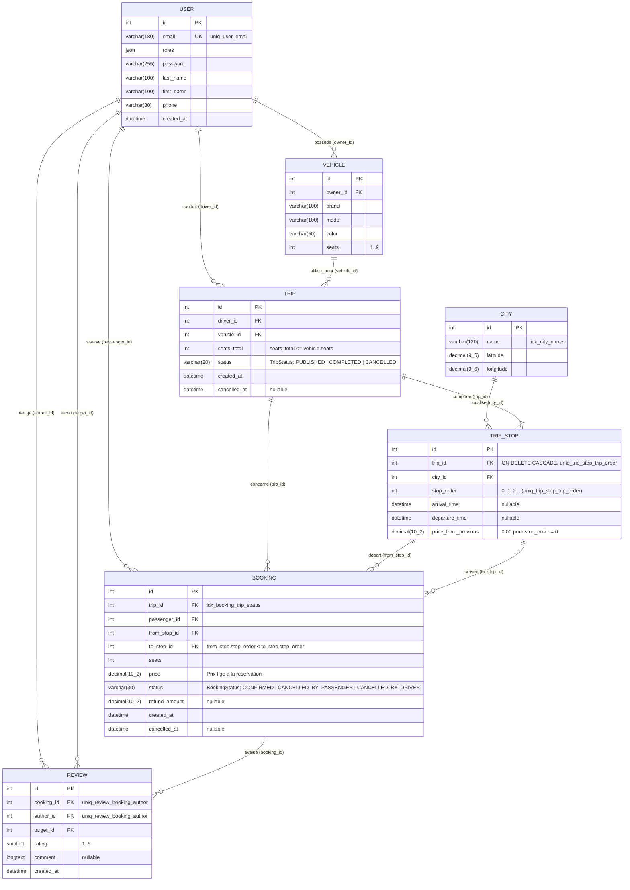

# Modèle de données — Covoiturage Régional au Maroc

Ce document décrit le modèle conceptuel et physique de la plateforme de covoiturage régional (PFE Challenge EMC — Sujet 3) ainsi que les justifications architecturales associées.

---

## 1. Diagramme Entité-Association (Mermaid `erDiagram`)

---

## 2. Justification des choix de conception

### 2.1. Découpage d'un trajet en segments (`TripStop` & `stopOrder`)
Plutôt que de modéliser un trajet comme une simple paire *(ville de départ, ville d'arrivée)*, un `Trip` est composé d'une séquence ordonnée d'arrêts `TripStop` numérotés par `stopOrder` ($0, 1, 2, \dots, n$).
- **Segments élémentaires** : Deux arrêts consécutifs d'ordres $k$ et $k+1$ forment le segment élémentaire $S_k = [k, k+1[$. Un trajet comportant $n+1$ arrêts est ainsi découpé en $n$ segments élémentaires.
- **Exemple régional marocain** : Sur un trajet **Casablanca (`0`) → Settat (`1`) → Marrakech (`2`) → Agadir (`3`)**, il existe 3 segments élémentaires : $[0,1[$, $[1,2[$ et $[2,3[$.
- **Calcul de disponibilité par portion** : Une réservation (`Booking`) allant de `fromStop` (ordre $i$) à `toStop` (ordre $j$, avec $i < j$) occupe `booking.seats` places sur tous les segments élémentaires $S_k$ tels que $i \le k < j$.
  - L'occupation du segment élémentaire $S_k$ est :
    $$\text{occupied}(k) = \sum_{\substack{b \in \text{bookings}(\text{CONFIRMED}) \\ b.\text{fromStop.stopOrder} \le k < b.\text{toStop.stopOrder}}} b.\text{seats}$$
  - Le nombre de places disponibles sur une portion quelconque $[i, j]$ est donc le minimum des places restantes sur chacun des segments traversés :
    $$\text{available}(i, j) = \text{trip.seatsTotal} - \max_{k \in \{i, \dots, j-1\}} \text{occupied}(k)$$
  - Ce modèle permet **nativement** de revendre sur `[Marrakech (2) → Agadir (3)]` une place occupée sur `[Casablanca (0) → Marrakech (2)]`, sans jamais dépasser la capacité du véhicule sur aucun tronçon.

### 2.2. Tarification additive par segment et prix figé (`Booking::price`)
- Chaque arrêt `TripStop` d'ordre $k \ge 1$ porte `priceFromPrevious` (`DECIMAL(10, 2)`), qui représente le prix unitaire d'une place sur le segment élémentaire $[k-1, k]$ (pour `stopOrder = 0`, `priceFromPrevious = 0.00`).
- Le tarif théorique d'une réservation de $s$ places entre les ordres $i$ et $j$ ($i < j$) est :
  $$\text{price} = s \times \sum_{k = i+1}^{j} \text{stop}_k.\text{priceFromPrevious}$$
- **Pourquoi figer `price` dans `Booking` ?** Une réservation constitue un contrat entre le passager et le conducteur à un instant $T$. Persister `booking.price` garantit l'immuabilité comptable de la transaction (notamment pour calculer `refundAmount` en cas d'annulation ultérieure), même si les tarifs des étapes étaient amenés à évoluer.

### 2.3. Pourquoi `seatsTotal` sur `Trip` en plus de `Vehicle::seats` ?
- `Vehicle::seats` représente la **capacité physique maximale** de places passagers du véhicule.
- `Trip::seatsTotal` représente le **quota de places effectivement mises en vente** par le conducteur pour ce trajet précis (avec la règle métier `trip.seatsTotal <= vehicle.seats`).
- Ce découplage répond à deux besoins concrets :
  1. **Flexibilité d'usage** : Un conducteur possédant une berline 4 places passagers peut ne proposer que 2 places sur un trajet spécifique (ex. présence d'un proche à bord ou coffre chargé de bagages).
  2. **Historisation** : Si le propriétaire modifie plus tard les caractéristiques de son véhicule, l'historique de capacité des trajets passés reste intact.

### 2.4. Enums PHP 8.1 Backed (`string`) pour les statuts
- [TripStatus](file:///c:/Users/OUALI/covoiturage-maroc/src/Enum/TripStatus.php) (`PUBLISHED`, `COMPLETED`, `CANCELLED`) et [BookingStatus](file:///c:/Users/OUALI/covoiturage-maroc/src/Enum/BookingStatus.php) (`CONFIRMED`, `CANCELLED_BY_PASSENGER`, `CANCELLED_BY_DRIVER`) sont des `enum` PHP 8.1 typés `string`.
- En PHP, ils interdisent tout état invalide à la compilation/exécution (typage fort des signatures). En base MySQL, ils sont stockés en `VARCHAR` lisibles (`CONFIRMED`, etc.), ce qui facilite le débogage SQL et évite les `ALTER TABLE ... MODIFY COLUMN ENUM(...)` coûteux lors de l'ajout futur d'un statut.

### 2.5. Index et contraintes d'intégrité
| Table | Nom de l'index / contrainte | Colonnes | Justification |
|---|---|---|---|
| `user` | `uniq_user_email` (`UNIQUE`) | `(email)` | Authentification rapide et unicité du compte utilisateur. |
| `city` | `idx_city_name` (`INDEX`) | `(name)` | Accélère l'autocomplétion et la recherche de trajets par nom de ville. |
| `trip_stop` | `uniq_trip_stop_trip_order` (`UNIQUE`) | `(trip_id, stop_order)` | Garantit qu'un trajet n'a jamais deux arrêts au même rang et accélère le tri `ORDER BY stop_order ASC`. |
| `booking` | `idx_booking_trip_status` (`INDEX`) | `(trip_id, status)` | Optimise le calcul de disponibilité qui filtre systématiquement sur `WHERE trip_id = ? AND status = 'CONFIRMED'`. |
| `review` | `uniq_review_booking_author` (`UNIQUE`) | `(booking_id, author_id)` | Empêche un utilisateur de déposer plusieurs avis pour une même réservation. |
